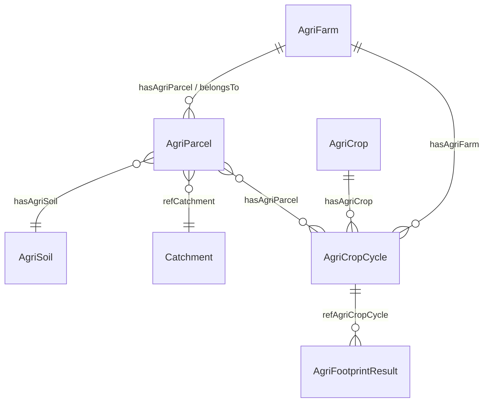

# NGSI-LD data model: agri-food LCA for contract farming (tenant `apetit_ccn`)

Status: **proposal**.
- New terms use the namespace `https://uri.fiware.org/ns/data-models/agrifood-lca/` (prefix `alca`).
- Reused terms keep their Smart Data Models IRIs (`https://smartdatamodels.org/dataModel.Agrifood/…`).
- `context.jsonld` holds all terms. The loader embeds it inline, or you can serve it and reference it with a Link header.

## Principles
1. **Reuse Smart Data Models first.** AgriFarm, AgriParcel, AgriSoil and AgriCrop come from `dataModel.Agrifood`. New types are added only where SDM has nothing: AgriCropCycle, AgriFootprintResult, Catchment.
2. **Raw in, never silently corrected.**
   - Values are stored as reported, with a `dataOrigin` sub-property.
   - Suspicious values are listed in `dataQualityFlags`; gaps in `missingAttributes`.
   - `reportingStatus` says why data is absent.
3. **Every filled or calculated value carries its provenance.** `dataOrigin` is one of: `reported` | `derived` | `farmHistory` | `imputed` | `default` | `hestia`. Filled values also carry `imputationMethod`, `imputationModel` and `confidenceInterval` where available. Reported values are never overwritten: filling only adds attributes, or adds separate result entities.
4. **Several footprints side by side.** The current calculator (`…-currentcalc`) and HESTIA (`…-hestia`) are separate AgriFootprintResult entities on the same crop cycle, so method differences stay visible.

## Entities

| Type | Origin | Key attributes |
|---|---|---|
| AgriFarm | SDM | name, location (Point), address, hasAgriParcel; alca: farmSegment, organicCertified, livestock, contractSince, contractCrops |
| AgriParcel | SDM | location (**Polygon**), area (m²), category, belongsTo, hasAgriSoil, soilTextureType; alca: organicSoil (+soilDataSource), clayContent, slope, distanceToWater, drainageType, bufferStrip, soilPhosphorus, refCatchment, **cropHistory** [{year, crop, catchCrop, status declared/planned}], missingAttributes |
| AgriSoil | SDM | name, soilTextureType; alca: organicSoil, soilDataSource |
| AgriCrop | SDM | name, alternateName (Finnish); alca: contractCrop |
| **AgriCropCycle** | new | One crop on one farm in one season (farm × crop × year, the unit of the survey). **Links:** hasAgriFarm, hasAgriCrop, hasAgriParcel (declared parcels). **Area and soil:** season, cropArea, declaredParcelArea, reportedSoilType, organicSoilShare (from the soil map). **Inputs:** fertiliserProduct, nitrogenMineralApplied, manureNitrogenApplied, phosphorusMineralApplied, dieselConsumption, limeApplied, pesticideApplications, irrigated, catchCropShare. **Outputs:** harvestedYield, deliveredQuantity. **Quality:** reportingStatus, missingAttributes, dataQualityFlags, dataSource; after HESTIA, hestiaStatus and hestiaAddedTerms |
| **AgriFootprintResult** | new | refAgriCropCycle, hasAgriCrop, season, systemBoundary, calculationMethod, characterisation (GWP set), ghgEmissionsPerArea, carbonFootprint (+functionalUnit), emissionBreakdown, dataOrigin. FLAG split attributes (nonFlagEmissions, flagLandManagementEmissions, flagLandUseChangeEmissions, flagRemovals, soilCarbonStockChange) are defined in the schema for later use |
| **Catchment** | new | name, location (Polygon), receivingWaterType, ecologicalStatus, nutrientRetention, catchmentArea, fieldAreaTotal, phosphorusSensitivity, monitoringStation, monitoredLoads [{year, totalPhosphorusKg, totalNitrogenKg}] |

**IDs:** `urn:ngsi-ld:<Type>:ccn:<key>`. Examples:
- `urn:ngsi-ld:AgriCropCycle:ccn:F0001-pea-2016`
- `urn:ngsi-ld:AgriFootprintResult:ccn:F0001-pea-2016-hestia`

Shared reference data uses `urn:ngsi-ld:AgriCrop:<crop>` and `urn:ngsi-ld:AgriSoil:soilmap-<class>`.

## Data-quality flags (on AgriCropCycle)
Each flag is written as `<type>:<attribute or reason>`. The types follow the issue types of the source package:

| Flag type | Meaning |
|---|---|
| `decimal_shift_suspected` | Mineral N is below 0.2× or above 6× the crop median (not counting 0) |
| `outlier_implausible` | Implausible value, e.g. N > 400 kg/ha; yield above 3× or below 0.15× the median; diesel above 2.5× the median |
| `area_mismatch` | Reported area differs from the declared parcels by more than 30% |
| `soil_misreport_suspected` | "Mineral soil" reported, but ≥ 30% of the declared area is organic on the soil map |

## Privacy
- In real data, a family farm can be a natural person, so farm and parcel data can be personal data under GDPR.
- Use pseudonymous farm IDs, keep the tenant access-controlled, and share via data-space usage policies.
- The data in this tenant is synthetic.
